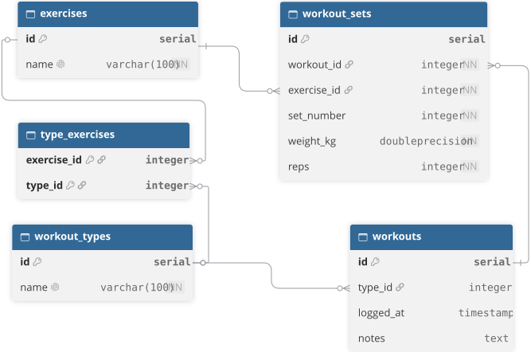

[Link for the website: mafendo.github.io/WorkOutTrack](https://mafendo.github.io/WorkOutTrack/)
## Databasstruktur

Databasen är uppbyggd kring fem tabeller i PostgreSQL för att hantera träningspass och historik:

* **`workout_types`** – Definierar träningspassens kategorier/splits (t.ex. *Bröst & Triceps*, *Rygg*, *Ben*).
* **`exercises`** – En katalog över alla tillgängliga övningar.
* **`type_exercises`** – Kopplingstabell (många-till-många) som mappar vilka övningar som hör till respektive passtyp.
* **`workouts`** – Själva träningstillfället med datum, tidpunkt och vald passtyp.
* **`workout_sets`** – Loggar varje enskilt set (vikt och repetitioner) kopplat till ett specifikt pass och en övning.